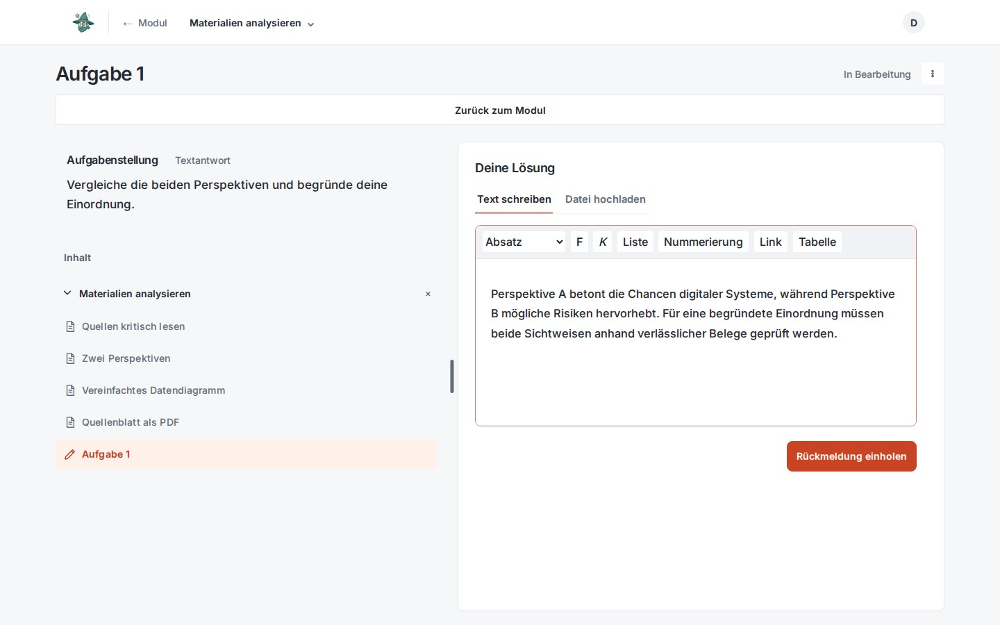

# Lernraum

GUSTAV-Version: 0.0.4
Zuletzt geprüft: 2026-11-01
[English version](learner-workspace.en.md)

## Zweck

Der Lernraum ist die zentrale Arbeitsfläche der Lernenden. Er hält Kurs, Lernweg, Materialien, Aufgaben und frühere Bearbeitungen in einem gemeinsamen Zusammenhang. Dieses Kapitel hilft Lehrkräften nachzuvollziehen, was Lernende tatsächlich sehen und bedienen können.

## Voraussetzungen

- Die lernende Person ist Mitglied eines aktiven Kurses.
- Dem Kurs ist mindestens eine Lerneinheit zugeordnet.
- Der gewünschte Abschnitt beziehungsweise Graphknoten ist sichtbar und bei modularen Lerneinheiten freigeschaltet.
- Benötigte H5P-Inhalte und Dateien sind vollständig gespeichert.

## Schritt für Schritt

1. Die lernende Person öffnet **„Lernraum“** und wählt unter **„Aktuelle Kurse“** einen Kurs.
2. Sie öffnet eine sichtbare Lerneinheit. Bei modularen Lerneinheiten zeigt der Graph den Lernweg und die Zustände der einzelnen Knoten. Der räumliche Graph bleibt auch auf Smartphones und Tablets verfügbar. Auf schmalen Bildschirmen beginnt eine neue Ansicht bei einem ausgewählten oder offenen Modul; wenn keines vorhanden ist, beim ersten Modul. Der Graph lässt sich verschieben und vergrößern. „Gesamtansicht“ zeigt alle Phasen, „Auswahl fokussieren“ führt zum lesbaren Modul zurück. Ein bereits gespeicherter Ausschnitt wird beim Wiederöffnen wiederhergestellt.
3. Sie wählt einen offenen Knoten beziehungsweise Abschnitt. Materialien und Aufgaben erscheinen in der Arbeitsfläche.
4. Markdown-Texte werden direkt gelesen. Dateien werden über **„Datei öffnen“** geladen. Eine interaktive Simulation wird bewusst mit **„Simulation starten“** geöffnet und kann zurückgesetzt oder geschlossen werden.
5. Eine Aufgabe öffnet ihren Arbeitsraum mit Rückweg zum Modul beziehungsweise zu den Inhalten. Weitere Kontextaktionen stehen im Menü der Kopfzeile. Die Bearbeitung kann später wieder aufgenommen werden, soweit der gespeicherte Zustand dies unterstützt; ein ungesendeter Textentwurf bleibt an den aktuellen Tab gebunden.
6. Für Übungsmodule wechselt die lernende Person über **„Üben“** in den gesonderten Wiederholungsablauf.

## Lernendensicht

Phasen stehen untereinander; innerhalb einer Phase führen die Pfeile von links nach rechts. Lange Lernwege laufen normalerweise nach vier Modulspalten in der nächsten Zeile links weiter. Verzweigungen bleiben bis zur Zusammenführung zusammen und können deshalb breiter werden. Module ohne Verbindungen stehen als freie Auswahl in einem Raster. Lehrkräfte und Lernende sehen dieselbe räumliche Karte; Farben und Aktionen zeigen den jeweiligen Arbeitsstand beziehungsweise die Berechtigungen.

Lernende sehen nur eigene aktive Kurse, zugeordnete Lerneinheiten und zugängliche Inhalte. Im modularen Graphen bleiben auch gesperrte Lernschritte als Orientierung sichtbar, können aber nicht geöffnet werden. Offene und erledigte Knoten zeigen den individuellen Lernstand, nicht den Stand der ganzen Klasse.

Materialien, Aufgabe, eigene frühere Abgaben und Rückmeldungen werden kontextbezogen dargestellt. Interne technische IDs, Musterlösungen, Kriterien und Lehrkraft-Kontext werden nicht als versteckte Hilfen ausgeliefert.

Während einer Aufgabe klappt ein Klick auf einen Materialtitel in der bestehenden linken Seitenleiste den Inhalt direkt darunter auf oder zu. Ohne gespeicherten Aufklappzustand sind die Materialien zunächst geschlossen; mehrere dürfen gleichzeitig offen bleiben. Die Aufgabe bleibt daneben bedienbar, einschließlich gewählter H5P-Antworten. Auf schmalen Bildschirmen wechselt **„Aufgabe | Materialien“** zwischen den erhalten bleibenden Arbeitsflächen. Nur **„Groß lesen“** öffnet die gesonderte Großansicht; frühere eigene Abgaben behalten ihren bisherigen Leser. Simulationen benötigen auch im aufgeklappten Material ausdrücklich **„Simulation starten“**.

Bei H5P-Aufgaben unterscheidet GUSTAV ausdrücklich zwischen **„Noch nicht bearbeitet“**, **„Noch nicht abgeschlossen“** und **„Abgeschlossen“**. Abgeschlossen ist eine H5P-Aufgabe erst, wenn mindestens einmal die volle Punktzahl erreicht wurde. Der zusätzlich angezeigte Punktestand stammt immer aus dem neuesten Versuch; ein späterer Teilversuch nimmt einen früher erreichten Abschluss nicht zurück.

**„Vollbild“** vergrößert eine H5P-Aufgabe innerhalb des Browsers. **„Vollbild verlassen“** oder Escape führt zurück; die bereits ausgewählten Antworten bleiben erhalten. Die Unterstützung ab iPadOS 15.3.1 bleibt bestehen.

„Bearbeitungsstand gespeichert.“ bestätigt unabhängig von der Punktzahl, dass deine H5P-Bearbeitung gespeichert wurde. Auch umfangreiche Antworten bleiben beim Neuladen im selben Tab erhalten. Noch nicht bestätigte Änderungen liegen kurzfristig nur in diesem Tab und werden beim Wiederöffnen übertragen. Warte vor dem Schließen des Tabs auf die Bestätigung. Zeigt GUSTAV einen Speicherfehler oder der Browser eine Warnung, bleibe auf der Seite, bis die Sicherung wieder gelingt. Ein geschlossener Tab oder verlorener Browser-Speicher kann unbestätigte Änderungen verwerfen.

Die Modulansicht und der Aufgabenraum teilen dieselbe Inhaltsnavigation. Auf schmalen Bildschirmen öffnet **„Inhalt“** das Verzeichnis. Im Aufgabenraum liegen Materialien und eigene frühere Abgaben im gemeinsamen Materialien-Bereich.

## Aufgabenentwürfe speichern

Normale Textantworten werden automatisch als privater Entwurf im Schülerkonto gespeichert. **„Entwurf gespeichert – noch nicht abgegeben“** bestätigt die Sicherung auf dem Server. Danach lässt sich die Aufgabe auch nach einem Browserwechsel oder auf einem anderen Gerät fortsetzen. Speichern löst keine KI-Rückmeldung aus und zählt nicht als Abgabe. Lehrkräfte sehen diese privaten Zwischenstände nicht.

Beim Schreiben erscheint kurz der Speicherstatus. Warte vor dem Schließen des Browsers auf die Bestätigung. Bei einem Verbindungsfehler bleibt der Text im offenen Tab erhalten; GUSTAV versucht die Sicherung erneut. **„Pausieren“** beziehungsweise der Rückweg aus der Bearbeitung wartet auf die Speicherung. Beim Wechsel über einen Seitenlink kannst du nach einem Fehler ausdrücklich trotzdem wechseln; ungesicherte Änderungen bleiben dann nur im bisherigen Tab erhalten.

Wenn dieselbe Aufgabe auf zwei Geräten bearbeitet wird, gewinnt der zuletzt gespeicherte Text. Geöffnete Editoren werden nicht laufend miteinander synchronisiert. Auch ein später wiederverbundener Tab kann mit seinen ungesicherten Änderungen einen anderen Stand ersetzen. Bearbeite dieselbe Aufgabe deshalb möglichst nur in einem Tab gleichzeitig.

Entwürfe haben keine feste Ablaufzeit. Auch Rückmeldung und endgültige Abgabe löschen sie nicht. Wird ein Kurs archiviert oder eine Freigabe entzogen, sind sie bis zur erneuten Berechtigung nicht zugänglich. Physische Löschung von Kurs, Aufgabe oder Mitgliedschaft entfernt die zugehörigen Entwürfe. Die Funktion betrifft normale Markdown-Aufgabenantworten; ungesendete KI-Dialogtexte, Uploads und Übungssitzungen gehören nicht dazu.

## So funktioniert es

Zugriff wird nicht nur durch ausgeblendete Schaltflächen geschützt. Kursmitgliedschaft, Zuordnung und Freischaltung werden bei jedem geschützten Abruf erneut geprüft. Private Dateien und H5P-Inhalte erhalten nur kurzlebige, auf den konkreten Lernkontext begrenzte Zugriffe.

Bei modularen Einheiten berechnet GUSTAV für jede Person, welche Voraussetzungen erfüllt sind. Der Graph dient zugleich als Advance Organizer: Lernende können erkennen, wo sie stehen und welche Schritte folgen, ohne gesperrte Inhalte vorzeitig zu öffnen.

## Grenzen

- Ein gesperrter Inhalt bleibt auch über einen kopierten Direktlink gesperrt.
- Noch nicht bestätigte Änderungen liegen nur im aktuellen Tab. Das Schließen des Tabs kann sie verwerfen; bestätigte Aufgabenentwürfe liegen im Schülerkonto.
- Simulationen laufen abgeschirmt und senden keine Ergebnisse an GUSTAV.
- Nicht jede Dateiform kann direkt als Vorschau dargestellt werden.
- Eine noch nicht fertig eingerichtete H5P-Aufgabe zeigt nur, dass sie nicht bereit ist.
- Der Lernraum arbeitet nicht offline. Für das Laden und Abgeben ist eine Verbindung zum GUSTAV-Server nötig.

## Typische Probleme

- **„Noch keine Lerneinheiten sichtbar“:** Prüfe Kursmitgliedschaft und Kurszuordnung der Lerneinheit.
- **Modul bleibt gesperrt:** Prüfe im Authoring die gerichteten Voraussetzungen und deren benötigte Anzahl. Bei einer vorausgesetzten H5P-Aufgabe muss mindestens einmal die volle Punktzahl erreicht worden sein.
- **Datei oder H5P lädt nicht:** Prüfe, ob Inhalt und Kurszuordnung noch bestehen; ein alter kurzlebiger Link kann nicht dauerhaft wiederverwendet werden.
- **Entwurf fehlt auf einem anderen Gerät:** Prüfe, ob die Speicherung im ursprünglichen Tab bestätigt wurde. Öffne anschließend die Aufgabe auf dem anderen Gerät erneut. Ungesendete KI-Dialogtexte sind hiervon ausgenommen.
- **Vergangener Kurs statt aktueller Kurs:** Der Kurs wurde archiviert und ist nicht mehr für aktive Bearbeitung vorgesehen.

## Verwandte Kapitel

- [Kurse und Mitglieder](courses-and-members.de.md)
- [Lerneinheiten und Freigaben](learning-units-and-releases.de.md)
- [Materialien und Aufgaben](materials-and-tasks.de.md)
- [Abgaben und Rückmeldung](submissions-and-feedback.de.md)
- [Übungsmodule](practice-modules.de.md)

Technische Details: [Learning-Referenz](../references/learning.md).
