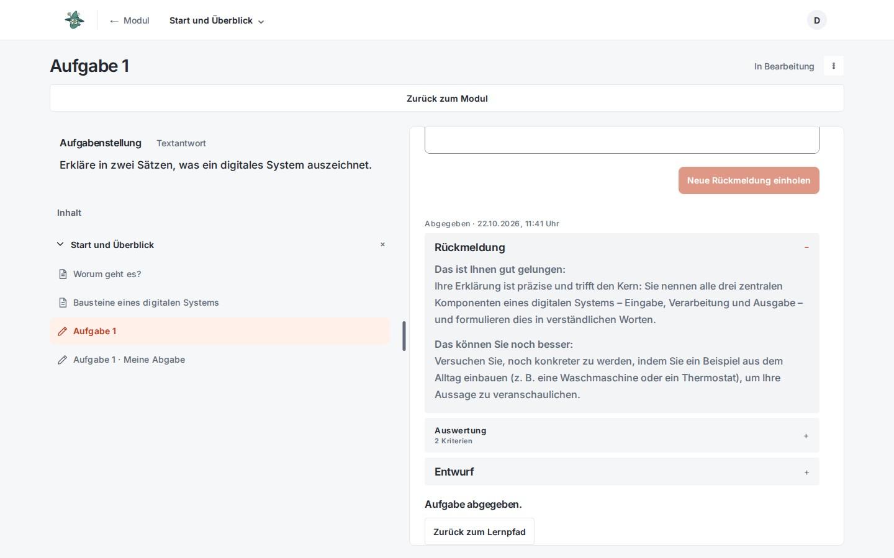

# Submissions and feedback

GUSTAV-Version: 0.0.4
Last verified: 2026-10-23
[Deutsche Version](submissions-and-feedback.de.md)

## Purpose

GUSTAV separates formative feedback from final submission. Learners can have a version reviewed, reflect on the feedback, and revise it before submitting that exact version as final.

## Prerequisites

- The task is accessible to the learner.
- The task type supports the intended text or file submission.
- For AI feedback, the analysis and feedback services are operational.
- Before a final submission, feedback has already been requested for the current version.

## Step by step

1. The learner writes an answer or selects a suitable file.
2. **„Rückmeldung einholen“** (“Request feedback”) saves the current version as an immutable attempt and queues it for evaluation.
3. While processing is underway, GUSTAV displays an in-progress state. When processing is complete, **„Rückmeldung“** (“Feedback”) opens. Its criterion judgements are available inside **„Kriterien im Detail“** (“Criteria in detail”).
4. **„Überarbeiten“** (“Revise”) returns to the text editor or file field. **„Abgeben“** (“Submit”) finalizes the already reviewed version.
5. Use **„Neue Rückmeldung einholen“** (“Request new feedback”) for changed text, a replacement file, or a switch from an image to text. With unreviewed text changes, **„Abgeben“** opens a warning: **„Weiter überarbeiten“** (“Continue revising”) returns to the editor; **„Trotzdem abgeben“** (“Submit anyway”) explicitly submits the previously reviewed version. A newly selected file requires feedback first.
6. After final submission, **„Aufgabe abgeschlossen“** (“Task completed”) replaces the editing actions. If another task in the same module is still open, the return button opens the module view; otherwise it opens the learning path. In a linear unit, it returns to the contents.

## Learner view

The interface distinguishes the editable draft from saved attempts. Previous submissions can be opened together with their feedback and criterion details. **„Kriterien im Detail“** (“Criteria in detail”) contains a numbered list; all individual criteria start closed, and each explanation can be expanded deliberately. Criteria are described without point values as **„Mangelhaft“** (“Poor”), **„Ansatzweise“** (“Partial”), **„Gelungen“** (“Successful”), or **„Hervorragend“** (“Excellent”) and additionally distinguished by a subtle colour marker. The written level remains authoritative; colour is only a visual aid. These terms apply only to the individual criterion, not to the learner. The action area deliberately stays flat: spacing and fine horizontal rules separate feedback, decisions, and criterion details instead of nested boxes. For file tasks, the file name, type, and available preview are displayed. In AI dialogues, final submission ends the dialogue and triggers the final evaluation.

For AI dialogues with a closing assignment, **„Gespräch → Abschlussaufgabe → Abgabe“** previews the steps. **„Zur Abschlussaufgabe“** opens that assignment; without one, the action is **„Zur Abgabe“**. **„Zurück zum Gespräch“** returns to the conversation. **„Gespräch und Antwort abgeben“** or **„Gespräch abgeben“** finalizes it. The result view puts the assignment and closing answer first, opens the feedback, and allows the conversation to be expanded.

## How it works

Every version sent to the server is saved as an immutable attempt. Duplicate transmissions are handled through repeatable requests. Before analysis, file uploads are checked for size, type, signature, and association with the task.

Processing runs in the background. GUSTAV publishes an evaluation and feedback only after they have been fully validated. A technical error does not change a saved answer; instead, the interface displays a sanitised error state.

AI feedback is formative. It is intended to encourage revision and is neither a grade nor an indisputable subject-matter judgement.

## Limitations

- An unsent editor draft is available only in the current browser tab.
- Final submission is possible only for the unchanged version most recently saved for feedback.
- Partial AI results are not displayed. If processing fails, feedback may be missing even though the answer has been saved securely.
- Permitted file formats and sizes depend on the task type; an unsuitable file is not accepted merely because it has been renamed with a different extension.
- Attempt limits are enforced by the server and cannot be bypassed by reloading the page or opening a second tab.
- The AI must not make a final pedagogical decision in place of the teacher.

## Common problems

- **„Überarbeitung noch nicht geprüft“** (“Revision not reviewed yet”): The text has changed or replaces a reviewed file. Request new feedback before submitting the current answer as final.
- **Feedback does not appear:** First wait while the in-progress state is displayed. If a persistent error occurs, the version can be submitted for feedback again.
- **File is rejected:** Use the original format expected for the task type and select the file again.
- **Double-clicking does not create a second submission:** This is intentional protection against duplicate attempts.
- **Session has expired:** Sign in again. GUSTAV attempts to restore the secure working context; nevertheless, check the draft before sending it again.

## Related chapters

- [Materials and tasks](materials-and-tasks.en.md)
- [Learning workspace](learner-workspace.en.md)
- [Live view](live-view.en.md)
- [Diagnostics](diagnostics.en.md)

Technical details: [Learning reference](../references/learning.md) and [Learning AI reference](../references/learning_ai.md).
