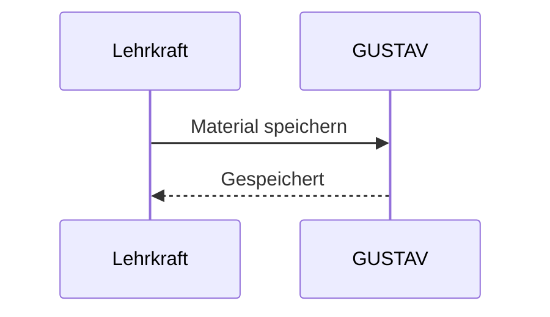

# Markdown: Code und Diagramme

Codeblöcke bewahren Zeilenumbrüche, Leerzeilen und Einrückungen. Lange Zeilen lassen sich innerhalb des Blocks seitlich verschieben. HTML wird als ungefährlicher Text angezeigt; nur `<br>` außerhalb von Code bedeutet einen Zeilenumbruch.

````markdown
```python
if wert < 3:
    print("Hallo")
```
````

Mit der Sprachmarkierung `mermaid` wird aus einem Codeblock ein Diagramm:

````markdown

````

Im bestehenden Editor entsteht ein solcher Block durch Eingabe von drei Backticks, `mermaid` und einem Leerzeichen. Innerhalb des Blocks wird der Diagrammtext bearbeitet. Die grafische Darstellung erscheint in der Leseansicht; „Quelltext anzeigen“ macht den ursprünglichen Diagrammtext zugänglich. Zum Verlassen eines Codeblocks kann am Blockende die Pfeiltaste nach unten verwendet werden. Eine zusätzliche Editorvorschau und neue Werkzeugschaltflächen sind nicht erforderlich.

Alle 37 nativen Diagrammtypen der eingebundenen Mermaid-Version 12.2.0 sind verfügbar. Externe Erweiterungen, Bilder und Ressourcenabrufe werden nicht unterstützt. Browser und PDF verwenden denselben internen Renderer. Im Browser benötigt die Diagrammdarstellung eine Verbindung zum GUSTAV-Server. Die Darstellung folgt dem GUSTAV-Farbschema; eigene Mermaid-Konfiguration kann die Vorgaben der Anwendung nicht verändern. Ein Diagramm ist auf 50.000 Zeichen begrenzt; für kantenbasierte Diagramme gilt zusätzlich Mermaids Grenze von 500 Kanten.

Bei einem Fehler bleiben Quelltext und übriger Inhalt lesbar. Der Fehler verhindert das Speichern nicht. Die vorhandene Funktion „PDF herunterladen“ erzeugt eine helle Druckfassung mit Diagrammgrafiken. Bei ungültigen oder zu großen Diagrammen enthält sie einen Hinweis und den Quelltext. Ein technischer Ausfall bei der Druckerzeugung wird als Fehler gemeldet.
